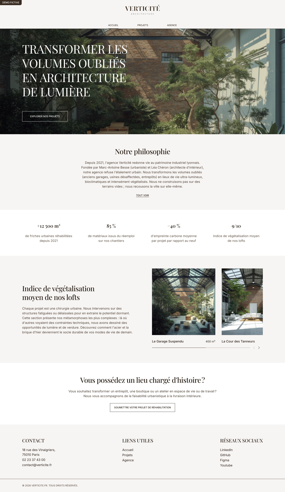

# Verticité — de la maquette Figma au thème WordPress

Site vitrine de **Verticité**, une agence d'architecture lyonnaise (fictive) qui transforme garages, usines et entrepôts en lieux de vie lumineux et végétalisés.

**[Voir la démo en ligne](https://verticite.tristanguyomard.fr)** · [Maquette Figma](https://www.figma.com/design/OfhepIM1zmZwcQTKQIJUHb/Verticit%C3%A9?node-id=31-7178&p=f)

J'ai mené ce projet de portfolio de bout en bout, **en trois étapes** : j'ai conçu la maquette, je l'ai intégrée en HTML / Sass, puis je l'ai transformée en thème WordPress sur mesure que le client peut modifier sans toucher au code.

<p align="center">
  
</p>

---

## Le projet en trois étapes

| Étape | Livrable | Ce qu'elle montre | Documentation |
|---|---|---|---|
| **1. Design** | Maquette Figma : 4 pages, desktop et mobile | Design system (couleurs, typographie, grille, espacements), maquettes responsive | [Voir la maquette](https://www.figma.com/design/OfhepIM1zmZwcQTKQIJUHb/Verticit%C3%A9?node-id=31-7178&p=f) |
| **2. Intégration** | HTML5 + Sass + JavaScript natif | Architecture CSS maintenable, design tokens, BEM, mobile-first, accessibilité | [`integration/README.md`](integration/README.md) |
| **3. WordPress** | Thème classique sur mesure + plugin | Hiérarchie des gabarits, type de contenu personnalisé, ACF, Settings API, widgets sur mesure, sécurité | [`wordpress/README.md`](wordpress/README.md) · [démo en ligne](https://verticite.tristanguyomard.fr) |

Chaque étape s'appuie sur la précédente : les noms des tokens Figma se retrouvent dans le Sass, et les classes CSS de l'intégration se retrouvent telles quelles dans les gabarits PHP.

```
Figma (design system)  →  Sass (tokens → variables CSS)  →  HTML (BEM)  →  PHP (gabarits WordPress + ACF)
```

---

## Compétences démontrées

**Design et intégration**
- Passage d'une maquette Figma à un code fidèle : les tokens de couleur, de typographie et d'espacement gardent les mêmes noms.
- Architecture Sass 7-1 avec le système de modules moderne (`@use` / `@forward`).
- Design tokens à trois niveaux (primitives → sémantiques → variables CSS) : une faute de frappe dans un nom de token **bloque la compilation**.
- BEM avec préfixes de rôle (`l-`, `c-`, `s-`, `u-`, `is-`).
- Mobile-first, 3 points de rupture, polices hébergées sur le site, aucune dépendance au chargement de la page.
- Accessibilité : lien d'évitement, navigation au clavier, `aria-*`, focus visible, `prefers-reduced-motion`.
- JavaScript natif en modules ES (menu mobile, carrousel), sans librairie.

**WordPress**
- Thème classique écrit à la main, sans constructeur de pages ni thème parent.
- Type de contenu « Projet » et taxonomie déclarés dans un **plugin**, pour que les données survivent à un changement de thème.
- Contenu entièrement modifiable avec **ACF**, avec les groupes de champs versionnés en JSON.
- Page de réglages « Agence » construite avec la **Settings API**, et **deux widgets sur mesure**.
- Sécurité : données échappées à l'affichage, nettoyées à l'enregistrement, envoi de SVG réservé aux administrateurs.

**Méthode**
- Code commenté en français, une responsabilité par fichier.
- Un seul outil de build (`sass` via npm) et des scripts documentés.
- Dépôt propre : seul le code que j'ai écrit est versionné.

---

## Structure du dépôt

```
.
├── README.md                ← vous êtes ici
├── package.json             # Scripts de compilation Sass
│
├── integration/             # Étape 2 : intégration HTML / Sass
│   ├── README.md
│   ├── index.html, projets.html, detailed_project.html, agence.html
│   ├── sass/                # Sources Sass (architecture 7-1), partagées avec le thème
│   ├── js/                  # Modules ES : menu, carrousel (copiés dans le thème)
│   ├── public/              # Polices, images, logos
│   └── main.css             # CSS compilé
│
└── wordpress/               # Étape 3 : WordPress
    ├── README.md
    ├── themes/verticite/    # Thème sur mesure
    └── plugins/archi-agence/  # Type de contenu « Projet » + taxonomie
```

---

## Démarrage rapide

Prérequis : [Node.js](https://nodejs.org/) 18 ou plus.

```bash
npm install
```

Pour voir l'intégration statique sur http://localhost:3000 :

```bash
npm run serve
```

Pour recompiler le CSS : le même Sass (`integration/sass/`) produit le CSS de l'intégration et celui du thème, qui est minifié et ne diffère que par le chemin des polices :

```bash
npm run build
```

Pour installer le thème dans un WordPress, voir [`wordpress/README.md`](wordpress/README.md#installation).

| Script | Rôle |
|---|---|
| `npm run build` | Compile l'intégration et le thème |
| `npm run build:integration` / `watch:integration` | `integration/sass` → `integration/main.css` |
| `npm run build:theme` | Même Sass → `assets/css/main.css` du thème (minifié) + copie de `integration/js` dans le thème |
| `npm run watch:theme` | Recompile le CSS du thème à chaque modification |
| `npm run images` | Génère les images WebP en plusieurs largeurs (`integration/public/images/optimized/`) |
| `npm run serve` | Sert l'intégration statique en local |

Le Sass et le JavaScript n'existent **qu'en un seul exemplaire**, dans `integration/`. Le thème les réutilise : une correction profite aux deux versions.

---

## Qualité mesurée

Scores Lighthouse (mobile / desktop), détaillés page par page dans chaque README :

| | Performance | Accessibilité | Bonnes pratiques | SEO |
|---|:---:|:---:|:---:|:---:|
| **Intégration** | 93–100 / 100 | 100 | 100 | 100 |
| **WordPress** ([site en ligne](https://verticite.tristanguyomard.fr)) | 99–100 / 100 | 100 | 100 | 100 |

Une première mesure donnait 73 à 77 en performance mobile pour les deux versions. Les corrections : images en WebP avec des `srcset` / `sizes` adaptés à chaque mise en page (génération par script dans l'intégration, par WordPress dans le thème), chargement différé du carrousel, zone tactile de 24 px minimum dans le pied de page, et `meta description` générée par le thème. Le poids de l'accueil statique passe de 4,3 Mo à 0,5 Mo, celui de la page Agence WordPress de 3,4 Mo à 0,5 Mo.

---

## Stack

| | |
|---|---|
| **Design** | Figma |
| **Front** | HTML5, Sass (Dart Sass, modules), JavaScript natif (modules ES) |
| **CMS** | WordPress 6.5 ou plus (testé en 7.1), PHP 8.1 ou plus, Advanced Custom Fields (version gratuite) |
| **Environnement local** | Local (by Flywheel), Node.js / npm |

---

## Auteur

[tristanguyomard.fr](https://tristanguyomard.fr)

Verticité est une agence fictive créée pour ce projet. Les polices Inter et Playfair Display sont sous licence SIL Open Font License (voir `integration/public/fonts/`).
